<!--
Rebuild locally:  python scripts/build_all.py
Daily refresh:    .github/workflows/refresh-profile.yml
The Mine/ folder is private and must stay untracked.
-->

 

 

<h3><code>ali@github ~ $ ./snake.sh</code></h3>

 

<h3><code>ali@github ~ $ whoami</code></h3>

<table width="100%">
<tr>
<td width="50%" valign="top"></td>
<td width="50%" valign="top"></td>
</tr>
</table>

 

<h3><code>ali@github ~ $ ./contributions.sh</code></h3>

 

<h3><code>ali@github ~ $ ./work.sh</code></h3>

<a href="https://github.com/AliHassan-15/DEEPMED-Testing"><b>DeepMed</b></a>
&nbsp;·&nbsp;
<a href="https://github.com/AliHassan-15/HAULIX"><b>HAULIX</b></a>
&nbsp;·&nbsp;
<a href="https://github.com/AliHassan-15/RELAY"><b>RELAY</b></a>
&nbsp;·&nbsp;
<a href="https://github.com/AliHassan-15/Underwater-Image-Enhancement-System"><b>Underwater</b></a>
&nbsp;·&nbsp;
<a href="https://github.com/AliHassan-15/RouteWise-ELD"><b>RouteWise ELD</b></a>
&nbsp;·&nbsp;
<a href="https://github.com/AliHassan-15/Brain-Tumor-Classification"><b>Brain Tumor MRI</b></a>

 

<h3><code>ali@github ~ $ ./links.sh</code></h3>

<b>Full-Stack Developer · Python · AI/ML</b>

